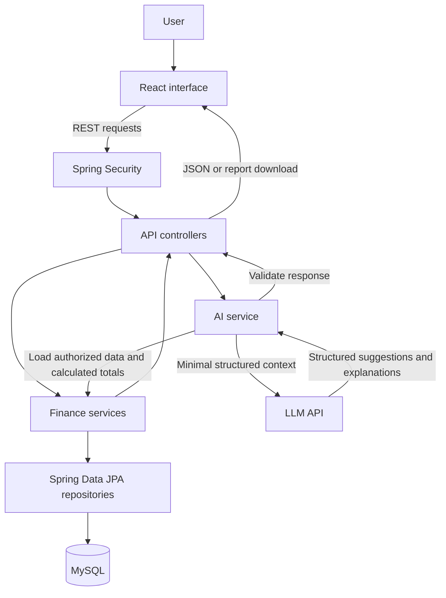
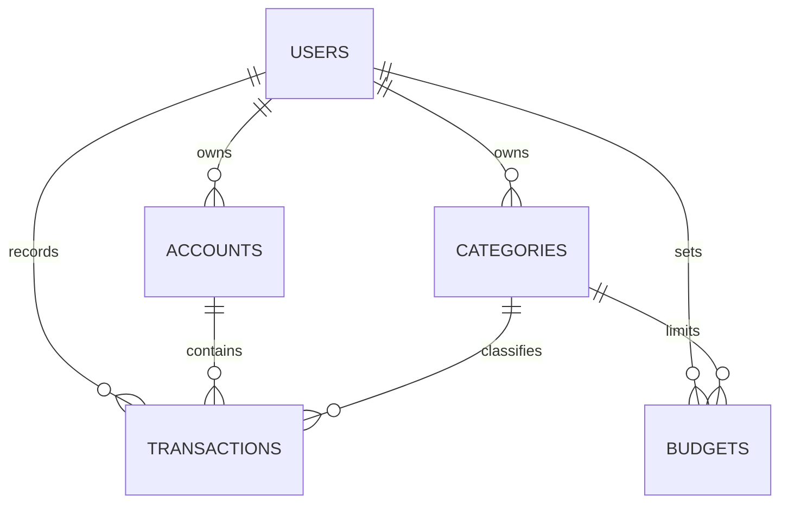

# Paisa: system design and build workflow

> Status update: the user authorized implementation. Paisa now has a working first version. See [the implementation and review guide](19-implementation-and-review.md) for verified behavior and pending integrations. Planning-only statements below record an earlier stage and no longer apply.

[Back to the file directory](../README.md)

**Current instruction:** planning only. Build the full agreed project when the user requests implementation. The steps below describe dependency order; they do not remove required features or limit the project to a small prototype.

## 1. System architecture

Use one React frontend, one modular Spring Boot backend, one MySQL database, and an external LLM API accessed only by the backend.

- React displays screens, collects input, calls APIs, and renders loading/success/error states.
- Spring Security supports authentication; backend services also enforce ownership of every requested account, category, transaction, and budget.
- Controllers validate request structure; services apply rules and exact-decimal money calculations.
- JPA repositories persist/read the five related MySQL tables.
- The AI service sends only the required authorized context to the provider, validates results, and returns them to the UI. Credentials stay on the backend.
- Manual transaction entry remains available when the AI provider fails. Report failures accurately.

## 2. Database relationships

Use five tables: `users`, `accounts`, `categories`, `transactions`, and `budgets`. Include primary keys, owner references, account/category references, timestamps where useful, and a unique user/category/month budget. Validate ownership and transaction/category type compatibility. Store money as exact decimals, use INR for the initial agreed project, and derive balances from opening balances and transactions.

## 3. API contract before implementation

Plan these groups, with final methods, paths, fields, validation, and errors recorded in `05-api-integration.md` before coding:

| API group | Responsibility |
| --- | --- |
| Authentication | Register, log in, get current user, log out |
| Accounts | Create/list/update supported accounts and show derived balances |
| Categories | Provide user-owned income/expense categories and defaults |
| Transactions | Add/list/edit/delete records and apply history filters |
| Budgets | Set monthly category budgets and show actual spending/progress |
| Analytics | Calculate selected-month totals, category breakdown, and trends |
| Reports | Download authorized selected-month CSV data and summary |
| AI categorization | Suggest an allowed category for a proposed expense |
| AI monthly intelligence | Return distinct patterns, budget recommendations, and monthly summary using actual data |

## 4. Screen and component design

Plan authentication, overview, transactions, budgets/accounts, and AI insights. Set navigation, visual hierarchy, typography, color, spacing, charts, forms, and interaction states before implementation expands. Reuse shared components so the full app remains consistent.

Use realistic fictional sample records for visual planning and testing. Clearly distinguish sample/mock behavior from connected functionality.

## 5. Implementation order, when requested

| Step | Work | Completion check |
| --- | --- | --- |
| 1 | Finalize architecture, schema, API contract, and screen outline | Responsibilities, data flow, and feature ownership are clear |
| 2 | Verify backend MySQL credentials, LLM API configuration, and hosting; create frontend/backend skeletons and validate minimal deployment early | Tools and external dependencies actually work |
| 3 | Implement schema management, authentication, account/category handling, and transaction services | Protected API persists valid data and isolates users |
| 4 | Implement budgets, deterministic analytics, and downloadable reports | Backend calculates correct results and exports authorized data |
| 5 | Implement the polished React screens against the agreed API contracts | Forms, navigation, data views, and interaction states work |
| 6 | Connect and demonstrate all four AI features | Categorization, pattern analysis, budget suggestions, and summaries each have a distinct visible result |
| 7 | Verify the complete app and polish layouts | Main journey, validation, user isolation, persistence, AI failure handling, and responsive views pass checks |
| 8 | Finalize live deployment, artifacts, and presentation | Live frontend/backend/MySQL, GitHub URL, ER diagram, Postman collection, README, and demo are ready |

Frontend component work and backend work may alternate as needed; the data contract keeps them aligned. Keep a runnable version at each milestone. Do not defer cloud connectivity until the final step.

## 6. Main runtime workflows

### Recording an expense

User fills the React form → optional AI category request → Spring Boot validates category suggestion → user accepts/corrects it → authenticated save request → backend validates fields and ownership → MySQL persists the record → analytics are recalculated → React refreshes history, balances, and budget progress.

### Monthly intelligence

User selects month and requests insights → Spring Boot loads their records/budgets → Java computes totals/comparisons → AI service sends minimal relevant context to the LLM → backend validates structured output → React displays separate pattern analysis, budget recommendations, and summary sections. Applying a recommendation requires the user's selection and a normal validated budget update.

### Reports

User chooses month and downloads → authenticated backend loads only their matching data → generates CSV with appropriate cell escaping and spreadsheet-formula protection → browser downloads it.

## 7. Project organization

Planned source locations, not created yet:

- `frontend/`: screens, components, styles, API access, and UI state.
- `backend/`: security/configuration, controllers, validated request/response models, services, entities, repositories, AI integration, migrations, and meaningful tests.
- `database/`: ER diagram and supporting database documentation/demo-data references, coordinated with authoritative backend migrations.
- `docs/`: feature explanations, actual source paths, verification results, deployment/run instructions, and presentation material.

Keep each responsibility easy to locate; update the file directory as implementation produces real files.

## 8. Scope and reasoning choices

All core requirements and all four named AI features remain in the agreed scope. Unusual-spend alerts are an extra candidate. The total build window is five hours, so keep implementation focused and avoid adding unrelated capabilities before required functionality and delivery are complete.

Use **High** for architecture, schema/API decisions, and difficult debugging. Use **Medium** for routine implementation once those decisions are settled. The assistant recommends the next level after completed work; it cannot automatically change this chat's setting.
