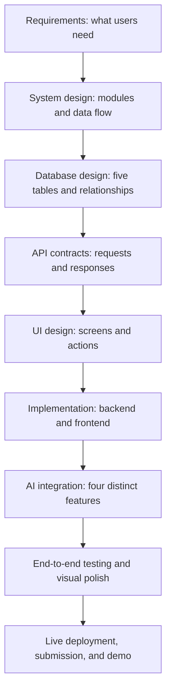
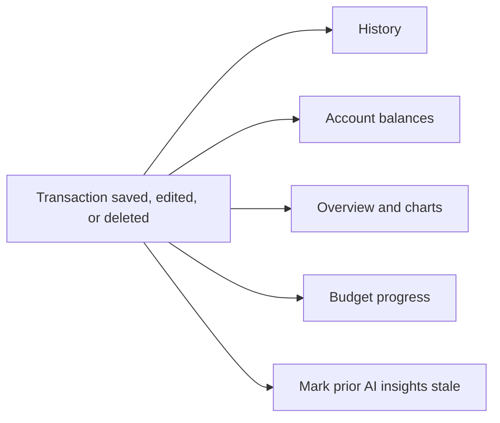

# Paisa pipeline

> Status update: the user authorized implementation. Paisa now has a working first version. See [the implementation and review guide](19-implementation-and-review.md) for verified behavior and pending integrations. Planning-only statements below record an earlier stage and no longer apply.

[Back to the file directory](../README.md)

**Status:** planning only. This describes the full agreed project; no application code has been created.

## Build pipeline

Verify database credentials, LLM API configuration, and hosting access during design/setup. Validate a minimal cloud deployment early during implementation, then complete and test delivery at the end.

## Common runtime pipeline

**User action → React sends a request → Spring Boot checks authentication and input → service applies rules → JPA reads/writes MySQL → backend returns a result → React updates the interface.**

Authentication entry points permit registration/login; protected features require an authenticated user. Enforce ownership in services before accessing or changing financial records. Keep money calculations in Java and credentials on the backend.

AI requests extend the service step: **load the relevant authorized data → compute facts in Java → send minimal context to the LLM → validate the returned result → show suggestions or explanations.** AI is requested explicitly rather than called on every screen render.

## Each feature: input → processing → result

| Feature | Input / trigger | Processing | Result / what happens next |
| --- | --- | --- | --- |
| Registration | Name, email, password → Register | Validate, hash password, create user and default categories | Registration succeeds; user continues into the authenticated setup flow |
| Login / logout | Credentials → Log in; account action → Log out | Verify identity/start authenticated session; end it on logout | Open dashboard after login; return to login after logout |
| Account management | Account name, type, opening balance → Save | Validate and persist user-owned account | Account is available in transaction forms; its balance is derived from opening balance plus transactions |
| Categories | Choose a category, or create/update one | Validate type/name and ownership; persist changes | Transaction form and relevant budget choices use the category |
| Income entry | Amount, date, description, account, category → Save income | Validate ownership and fields; persist an income record | History, account balance, monthly income, and net cash flow update |
| Expense entry | Amount, date, description, account, category → Save expense | Validate ownership and fields; persist an expense record | History, account balance, spending charts, and budget progress update |
| AI expense categorization | Expense description → Suggest category | Send description plus allowed categories to LLM; validate returned category | Show suggestion → user accepts/corrects → normal Save expense pipeline |
| Transaction history | Month/account/category/type/search filters | Query only matching records belonging to the user | Display filtered history; edit opens the form and save updates results |
| Edit / delete transaction | Edited fields → Save; selected transaction → confirm Delete | Revalidate ownership; update/delete the record | Refresh history, balances, analytics, and budgets; mark existing AI analysis stale |
| Monthly budgets | Month, expense category, limit → Save budget | Validate; save one budget per user/category/month; total matching expenses | Show spent, remaining, and progress; later expense changes refresh these values |
| Expense analytics | Select month | Calculate income, expenses, net cash flow, category totals, and trend | Update dashboard cards/charts; category drill-down opens matching transaction history |
| AI spending patterns | Selected month → Analyze spending | Load actual spending and valid comparison periods; calculate facts; request and validate AI observations | Show evidence-backed pattern analysis; insufficient history is stated explicitly |
| AI budget recommendations | Selected month → Recommend budgets | Load actual spending/income and current budgets; request and validate category suggestions | Show proposed amounts and reasons → user reviews/selects → Apply uses normal budget-update pipeline |
| AI monthly summary | Selected month → Generate summary | Compute real totals; ask LLM for a grounded narrative; validate figures | Show monthly summary; View report opens the selected month's report |
| Downloadable report | Selected month/filters → Download CSV | Query authorized matching data; format transactions and numeric summary; escape CSV safely | Browser downloads the file; report screen remains available |

## What changes together

Budget changes refresh budget views and mark relevant recommendations stale. Changes to transaction descriptions/categories also affect future AI analysis. Switching month changes the requested dataset, not stored records.

## Failure pipeline

- Invalid form → show field errors → keep entered values → correct and resubmit.
- Expired login → return to sign-in → resume authorized navigation after successful login.
- Database/API failure → display failure and retry action; do not show a successful save.
- LLM failure → display AI unavailable/retry; retain manual categorization and core finance functionality.
- No transactions/history → show an honest empty/insufficient-data state and the relevant add-transaction action.

## Demonstration pipeline

**Log in → add account if needed → add income → enter expense → request AI category → save → see dashboard/budget changes → analyze spending → review/apply budget suggestion → generate monthly summary → download report.**

Required features stay in scope. Extra unusual-spend alerts follow once the full required pipeline is reliable. See [system design](16-system-design-and-build-workflow.md) for architecture details and [project scope](14-finance-project-scope.md) for acceptance checks.
